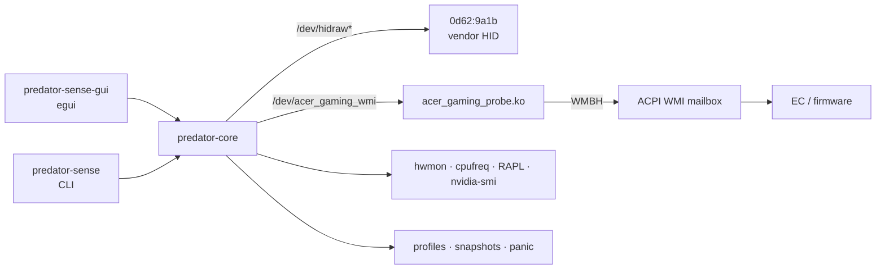

<p align="center">
  
</p>

<h1 align="center">PredatorSense Linux</h1>

<p align="center">
  <strong>Unofficial Linux control panel for Acer Predator lighting, fans, MagForce keys and overclocking.</strong>
</p>

<p align="center">
  <a href="https://github.com/AxDSan/predator-sense-linux/actions/workflows/ci.yml"></a>
  <a href="LICENSE"></a>
  
  
  
</p>

<p align="center">
  <a href="#install">Install</a> ·
  <a href="#features">Features</a> ·
  <a href="#screenshots">Screenshots</a> ·
  <a href="#safety">Safety</a> ·
  <a href="docs/PARITY.md">Parity</a> ·
  <a href="docs/RECOVERY.md">Recovery</a> ·
  <a href="CONTRIBUTING.md">Contributing</a>
</p>

---

## Why

Acer ships PredatorSense for Windows. On Linux the lighting, fan, MagForce and
overclock controls are not exposed by the stock `acer_wmi` driver, and the
vendor HID protocol is undocumented.

This project implements the hardware-control surface natively:

- **Rust core** (`predator-core`) — protocol, WMI bridge, HID framing, keymap,
  sensors, profiles, snapshots and safety policy.
- **`predator-sense`** — scriptable CLI for every operation.
- **`predator-sense-gui`** — an egui control panel with a per-key RGB editor,
  dashboard, fan control, overclocking, MagForce, power tuning, profiles,
  diagnostics and recovery.
- **`acer_gaming_probe.ko`** — a small GPL kernel module that exposes the ACPI
  `WMBH` gaming-function mailbox as `/dev/acer_gaming_wmi`.

No firmware is flashed. Every write is a reversible WMI mailbox call or a HID
feature/output report.

> **Verified on:** Acer Predator PH717-71 (Helios 700), board `Levante_CFS`,
> BIOS V1.05, Fedora 43, kernel 7.0.12, NVIDIA RTX 2070 Mobile.
> Other Predator models may share parts of the protocol; see
> [`docs/PARITY.md`](docs/PARITY.md) and run `predator-sense doctor`.

---

## Features

| Area | What works | Status |
|---|---|---|
| **Per-key RGB** | 103-key `en-us` layout, 128-slot HID colour buffer, paint by click/drag, presets | Verified |
| **Effects** | Static, Breathing, Neon, Wave, Ripple, Rainbow, Snake, Zoom, Spot, Star, plus raw effect IDs | Verified |
| **Keyboard brightness** | 0–100 %, with live getter readback | Verified |
| **MagForce** | Actuation point, switch/linear/joystick mode, analog curve, replace mode, game keys | Verified |
| **Touchpad ring** | On/off, brightness (on this firmware the ring is not RGB) | Verified |
| **Heat-pipe light** | On/off | Verified |
| **Fans** | Auto, quiet/performance presets, manual duty per CPU/GPU group | Verified |
| **Sensors** | EC CPU/system/GPU temperatures, CPU/GPU fan RPM, clocks, package power, RAM, battery/AC | Verified |
| **Firmware OC** | Normal/Fast/Turbo CPU and GPU levels, Max-Q mode, GPU mode, POST sound | Implemented |
| **Linux OC equivalents** | RAPL PL1/PL2, NVIDIA power limit, locked GPU clocks | Implemented |
| **Profiles** | TOML profiles, JSON snapshots, export/import, auto-save, boot-time apply (enabled) | Implemented |
| **Recovery** | `panic`, snapshot/restore, dry-run, read-only, `--allow-oc` gate | Implemented |

See [`docs/PARITY.md`](docs/PARITY.md) for the full Windows-module inventory,
including the modules that remain Windows-only (App Center, GameSync, sound
profiles, BIOS logo, mobile pairing) and the XTU/NVAPI boundary.

---

## Screenshots

| Lighting — per-key editor | Dashboard |
|---|---|
|  |  |

| MagForce | Power / GPU tuning |
|---|---|
|  |  |

| Overclock | Recovery |
|---|---|
|  |  |

---

## Install

### Requirements

- Linux with the matching kernel headers, `dkms`, a C compiler and `make`.
- Rust **1.85+** (stable).
- A desktop with X11 or Wayland for the GUI (`libxkbcommon`, `libwayland`,
  `libX11`, OpenGL).
- `nvidia-smi` for GPU sensors/power controls (optional).

**Fedora**

```sh
sudo dnf install gcc make dkms kernel-devel cargo rust \
    libxkbcommon-devel wayland-devel libX11-devel mesa-libGL-devel
```

**Ubuntu / Debian**

```sh
sudo apt install build-essential dkms linux-headers-"$(uname -r)" \
    cargo rustc libxkbcommon-dev libwayland-dev libx11-dev \
    libgl1-mesa-dev libudev-dev pkg-config
```

> If your distribution's Rust is older than 1.85, install it with
> [rustup](https://rustup.rs/).

### Build and install

```sh
git clone https://github.com/AxDSan/predator-sense-linux.git
cd predator-sense-linux
cargo build --release
sudo packaging/install.sh
```

The installer:

- installs `predator-sense` and `predator-sense-gui` to `/usr/local/bin`;
- creates the `predator-sense` group, adds the invoking user, and installs the
  udev rule (`99-predator-sense.rules`);
- installs the desktop entry, the `predator-sense-apply.service` (enabled), and
  the docs;
- installs/refreshes the DKMS kernel module.

Log out and back in after the first install so the new group is active. A
fast debug install is available for development:

```sh
RELEASE=0 ./packaging/install.sh
```

### First run

```sh
predator-sense doctor      # devices, permissions, kernel module, sensors
predator-sense-gui         # control panel
```

If `doctor` reports a permission error, run:

```sh
sudo usermod -aG predator-sense "$USER"
# log out and back in
```

### Persistence

The GUI saves every change to the active profile within a second; every
successful CLI write also persists it. `sudo predator-sense ...` resolves the
invoking user through `SUDO_USER`, so it writes **your** profile rather than
`/root`. `predator-sense-apply.service` is enabled by the installer, waits for
udev to settle, and applies `default.toml` at boot as root:

```sh
sudo systemctl disable --now predator-sense-apply.service   # opt out
sudo systemctl status predator-sense-apply.service          # verify
```

The content area keeps a full-label sidebar and adds horizontal and vertical
scrollbars plus a 16 px gutter inside the frame, so narrow windows never hide
controls or draw the frame through a heading.

---

## Quick start

```sh
# Inspect
predator-sense doctor
predator-sense monitor
predator-sense magforce status

# Lighting
predator-sense lighting static --color '#00AEC7' --brightness 50
predator-sense lighting static --preset wasd --color '#FF0000'
predator-sense lighting effect --name Wave --speed 5 --direction 1 --brightness 50
predator-sense lighting brightness 30
predator-sense lighting off

# Chassis
predator-sense ring on --brightness 100
predator-sense ring off
predator-sense heatpipe on
predator-sense heatpipe off

# Fans
predator-sense fan quiet          # 35 %
predator-sense fan performance    # 90 %
predator-sense fan auto
predator-sense fan status

# MagForce
predator-sense magforce actuation 46
predator-sense magforce setting --switch-mode 0 --linear-mode 1 --joystick 0
predator-sense magforce analog 0
predator-sense magforce replace off --backlight-30s false

# Overclocking (AC power; --allow-oc; RAPL/NVIDIA writes need root)
sudo predator-sense --allow-oc oc cpu 1
sudo predator-sense --allow-oc oc gpu 1
sudo predator-sense --allow-oc oc power pl1 55
sudo predator-sense --allow-oc oc nvidia lock 300 1800
predator-sense oc power status
predator-sense oc nvidia status

# Turbo (the keyboard slide also triggers it in the GUI)
sudo predator-sense --allow-oc turbo apply
predator-sense turbo status
sudo predator-sense --allow-oc turbo restore

# Safety
predator-sense snapshot
predator-sense profile apply default
predator-sense restore --apply-profile
predator-sense panic
```

Use `--dry-run` to print the intended writes, `--read-only` to disable writes,
and `--allow-oc` to unlock EC/RAPL/NVIDIA writes. Every direct hardware write
takes a snapshot first (unless `--no-snapshot` is set).

---

## Architecture



- **Protocol facts** recovered from the shipped Windows service are documented
  in [`docs/PROTOCOL.md`](docs/PROTOCOL.md). No Acer firmware or decompiled
  application code is included.
- **Kernel boundary**: the module calls the exported `wmi_evaluate_method()` by
  GUID and exposes a `write(method_id, payload)` / `read()` device. It does not
  claim the WMI device or replace `acer-wmi`.
- **HID boundary**: 9-byte feature reports for commands/getters, 65-byte output
  reports for the 512-byte per-key colour buffer.
- **Safety**: writes are gated, snapshotted, and reversible; `panic` is always
  available. See [`docs/RECOVERY.md`](docs/RECOVERY.md).

---

## Safety and recovery

This tool does **not** write EC/SPI firmware, BIOS or NVRAM. The worst lighting
case is a stuck light; the worst overclock case is an unstable system.

```sh
predator-sense panic       # lights off, fans auto, OC normal
predator-sense snapshot    # capture a recovery baseline
predator-sense restore     # restore the safe state
```

Read [`docs/RECOVERY.md`](docs/RECOVERY.md) before overclocking. It covers:

- snapshots and restore;
- EC reset (hold power 15 s, unplug AC);
- BIOS setup defaults;
- removing the module, udev rule and boot service;
- OC recovery (firmware level, RAPL, NVIDIA clocks);
- permissions and the dedicated group;
- backup locations.

The Windows-only XTU/NVAPI layer is the main parity boundary: Acer's `.xtu`
profiles are encrypted, so this project sets the same class of limits through
RAPL (PL1/PL2) and the NVIDIA driver (power limit, locked clocks), plus the EC's
Normal/Fast/Turbo levels. Voltage offsets are not exposed by the Linux driver
and are not written by this tool.

---

## Development

```sh
cargo fmt --all --check
cargo clippy --workspace --all-targets -- -D warnings
cargo test --workspace
cargo build --release
```

The CI workflow runs formatting, Clippy, tests and a release build on Ubuntu.
Hardware work is tested on the PH717-71; see
[`CONTRIBUTING.md`](CONTRIBUTING.md) for the hardware-test protocol and the
clean-room contribution rules.

Project layout:

```
crates/predator-core/       protocol, WMI, HID, keymap, sensors, safety
crates/predator-sense/      CLI
crates/predator-sense-gui/  egui control panel
kmod/                       WMI-to-userspace bridge (GPL-2.0-or-later)
packaging/                  install/uninstall, udev, desktop entry
systemd/                    boot-time profile service (enabled)
docs/                       protocol, architecture, parity, recovery, screenshots
legacy/                     pre-Rust Python toolkit (reference only)
```

---

## Contributing · Security · Support

- [Contributing](CONTRIBUTING.md) — development setup, DCO, hardware reports,
  clean-room rules.
- [Security policy](SECURITY.md) — report vulnerabilities privately through
  GitHub Security Advisories.
- [Support](SUPPORT.md) — where to ask, what to include, issue templates.
- [Code of Conduct](CODE_OF_CONDUCT.md).

Do not include Acer firmware, decompiled application code, or other proprietary
material in issues or pull requests. Protocol facts and original code only.

---

## License

**GPL-2.0-or-later.** See [`LICENSE`](LICENSE) and [`NOTICE`](NOTICE).

The kernel module is GPL-2.0-or-later, matching the kernel ABI requirement. The
Rust crates use the same license to keep the project coherent.

---

## Disclaimer

PredatorSense, Predator, Helios, Acer and related marks are trademarks of Acer
Incorporated. This project is an independent, unofficial Linux reimplementation.
It is not affiliated with, endorsed by, or supported by Acer.

Overclocking and fan control change hardware behaviour. Use AC power, take a
snapshot, and read the recovery guide. You are responsible for your hardware.
