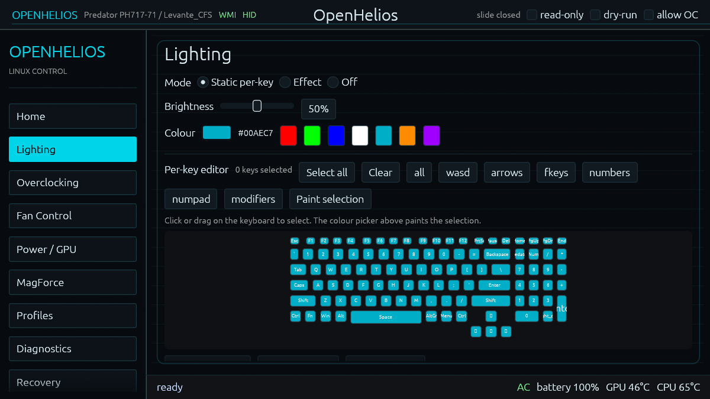
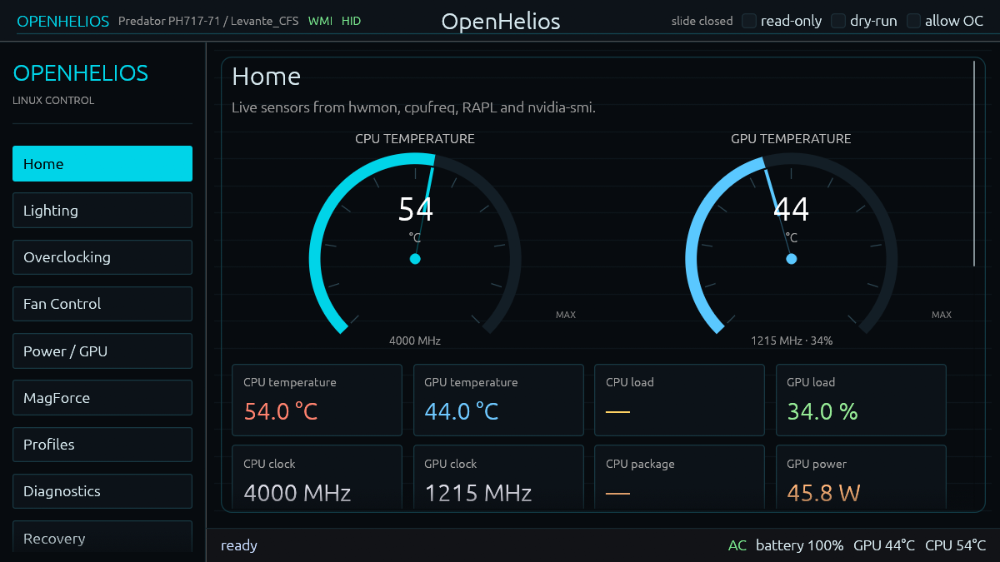
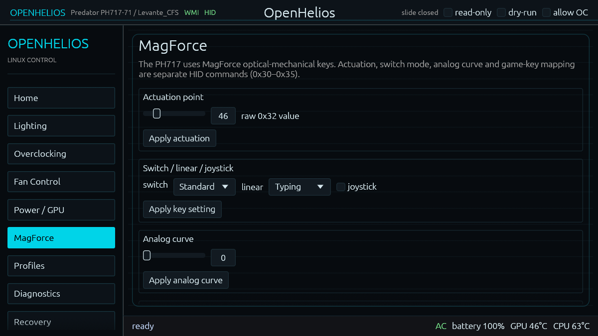
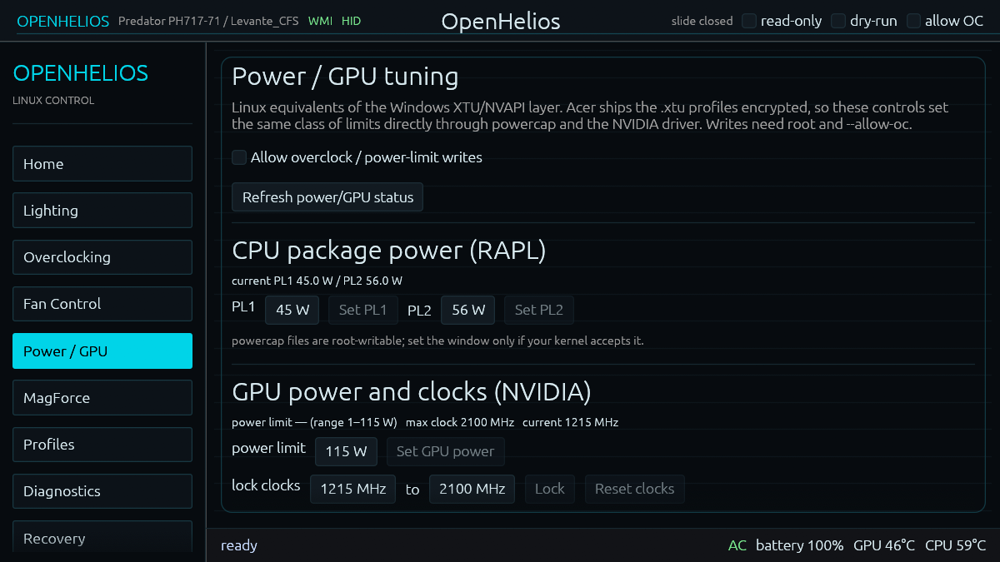
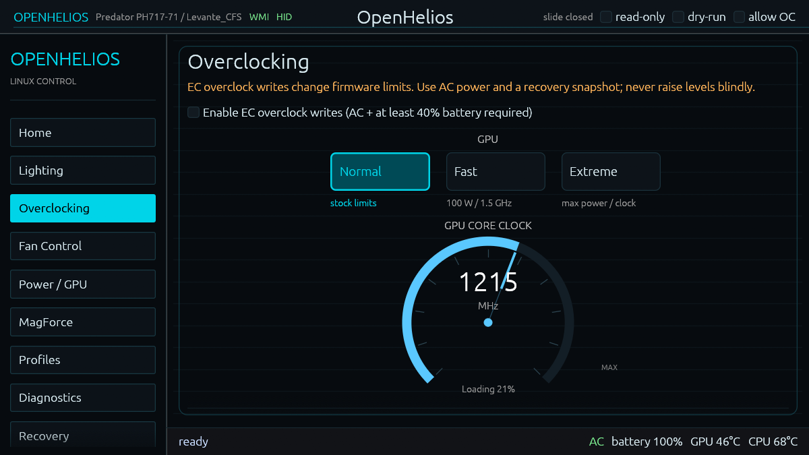
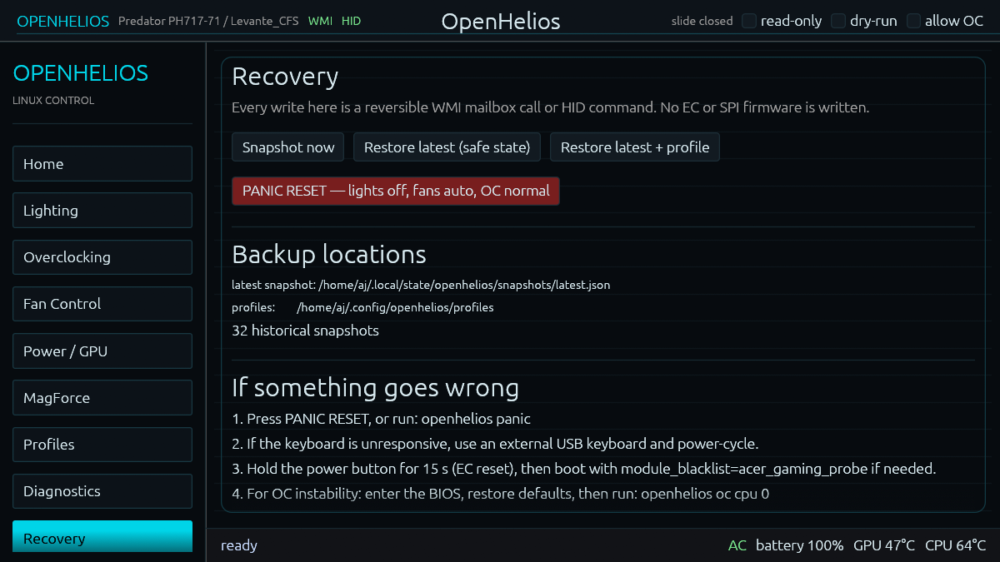
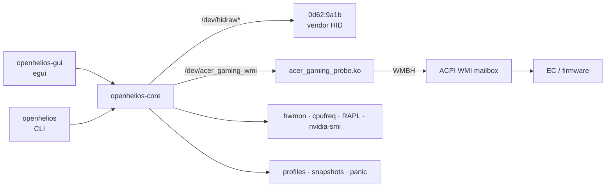

<p align="center">
  
</p>

<h1 align="center">OpenHelios</h1>

<p align="center">
  <strong>Independent Linux control panel for the Acer Predator Helios 700 (PH717-71): per-key RGB, fans, MagForce keys and overclocking.</strong>
</p>

<p align="center">
  <a href="https://github.com/AxDSan/openhelios/actions/workflows/ci.yml"></a>
  <a href="LICENSE"></a>
  
  
  
</p>

<p align="center">
  <a href="#install">Install</a> ·
  <a href="#features">Features</a> ·
  <a href="#provenance">Provenance</a> ·
  <a href="#screenshots">Screenshots</a> ·
  <a href="#safety">Safety</a> ·
  <a href="docs/PARITY.md">Parity</a> ·
  <a href="docs/RECOVERY.md">Recovery</a> ·
  <a href="CONTRIBUTING.md">Contributing</a>
</p>

---

## Why

Acer ships PredatorSense for Windows. On Linux the lighting, fan, MagForce and
overclock controls are not exposed by the stock `acer_wmi` driver, and the
vendor HID protocol is undocumented.

OpenHelios implements that hardware-control surface natively:

- **`openhelios-core`** — protocol, WMI bridge, HID framing, keymap, sensors,
  profiles, snapshots and safety policy.
- **`openhelios`** — scriptable CLI for every operation.
- **`openhelios-gui`** — an egui control panel with a per-key RGB editor,
  dashboard, fan control, overclocking, MagForce, power tuning, profiles,
  diagnostics and recovery.
- **`acer_gaming_probe.ko`** — a small GPL kernel module that exposes the ACPI
  `WMBH` gaming-function mailbox as `/dev/acer_gaming_wmi`.

No firmware is flashed. Every write is a reversible WMI mailbox call or a HID
feature/output report.

> **Verified on:** Acer Predator PH717-71 (Helios 700), board `Levante_CFS`,
> BIOS V1.05, Fedora 43, kernel 7.0.12, NVIDIA RTX 2070 Mobile.
> Other Predator models may share parts of the protocol; see
> [`docs/PARITY.md`](docs/PARITY.md) and run `openhelios doctor`.

**OpenHelios is an independent project.** It is not affiliated with, endorsed
by, or supported by Acer. Acer, Predator, Helios and PredatorSense are
trademarks of their respective owners. See [Provenance](#provenance) and
[`docs/PROVENANCE.md`](docs/PROVENANCE.md).

---

## What this project is, and what it is not

**It is:** an original Rust implementation of the hardware interfaces observed
on this laptop, built from public ACPI tables, USB HID descriptors, black-box
probing, and static inspection of the publicly distributed PredatorSense
package for functional interface details.

**It is not:** a copy or repack of PredatorSense; a formal clean-room project;
an Acer product; a distributor of vendor binaries, decompiled source, firmware,
icons, fonts or `.xtu` profiles; or a tool that decrypts Acer's encrypted
profiles.

The same maintainer performed the interface research and wrote the
implementation. The repository contains no vendor code or expressive assets,
and the Rust implementation is original, but the project does **not** claim a
certified clean-room separation. If you need that kind of audit, this
repository does not provide it. The full factual record,
including the four access/copying questions, is in
[`docs/PROVENANCE.md`](docs/PROVENANCE.md); it is not legal advice.

---

## Provenance

The protocol was identified from:

1. the public ACPI tables (`_WDG` and the `WMBH` method);
2. the USB HID report descriptors and reversible black-box probes;
3. WMI method/selector probing with snapshots;
4. the locally installed, publicly distributed **Desktop Bridge .NET**
   PredatorSense package, inspected with standard managed-metadata tooling to
   confirm method IDs, payload shapes and selector semantics.

The encrypted `.xtu` files were **not** decrypted and are not used. The project
sets the same class of CPU/GPU limits through public interfaces: RAPL/powercap
for PL1/PL2, `intel_pstate` for governor/EPP/frequency, and the NVIDIA driver
for power limits and locked clocks.

The repository contains no vendor binaries, decompiled application source,
firmware, extracted assets or `.xtu` files. The keyboard map is a functional
key-position map. Details and the repository check are in
[`docs/PROVENANCE.md`](docs/PROVENANCE.md).

| Question | This project |
|---|---|
| Lawfully obtained? | The analysis used the publicly distributed Microsoft Store package installed on the target machine; the package is not redistributed. |
| Terms restricting reverse engineering? | The project makes no claim that vendor terms permit the analysis. It does not redistribute vendor material; users and contributors must assess their own contractual obligations. |
| Encryption/authentication bypass? | No. Managed .NET metadata was inspected with standard tooling. Encrypted `.xtu` profiles were not decrypted and are not used. |
| Proprietary code/assets in the repo or releases? | None. Only original code, factual interface notes and screenshots of OpenHelios are tracked. |

This is a factual account, not legal advice.

---

## Verified versus implemented

- **Verified** means the behaviour was observed on the PH717-71 hardware with
  the getter/readback or the physical light/fan result.
- **Implemented** means a code path exists and is exercised, but not every
  firmware mode has been independently verified.

Only the rows marked *Verified* below were physically confirmed on this
machine. The firmware OC levels are accepted by the EC, but some modes may be
inert or model-specific. See [`docs/PARITY.md`](docs/PARITY.md).

---

## Features

| Area | What works | Status |
|---|---|---|
| **Per-key RGB** | 103-key `en-us` layout, 128-slot HID colour buffer, paint by click/drag, presets | Verified |
| **Effects** | Static, Breathing, Neon, Wave, Ripple, Rainbow, Snake, Zoom, Spot, Star, plus raw effect IDs | Verified |
| **Keyboard brightness** | 0–100 %, with live getter readback | Verified |
| **MagForce** | Actuation point, switch/linear/joystick mode, analog curve, replace mode, game keys | Verified |
| **Touchpad ring** | On/off, brightness (on this firmware the ring is not RGB) | Verified |
| **Heat-pipe light** | On/off | Verified |
| **Fans** | Auto, quiet/performance presets, manual duty per CPU/GPU group | Verified |
| **Sensors** | EC CPU/system/GPU temperatures, CPU/GPU fan RPM, clocks, package power, RAM, battery/AC | Verified |
| **Firmware OC** | Normal/Fast/Turbo CPU and GPU levels, Max-Q mode, GPU mode, POST sound | Implemented |
| **Linux OC equivalents** | RAPL PL1/PL2, NVIDIA power limit, locked GPU clocks | Implemented |
| **Turbo slide** | Hardware keyboard-slide watcher; fans/lights/OC apply and restore | Verified |
| **Profiles** | TOML profiles, JSON snapshots, export/import, auto-save, boot-time apply (enabled) | Implemented |
| **Recovery** | `panic`, snapshot/restore, dry-run, read-only, `--allow-oc` gate | Implemented |

See [`docs/PARITY.md`](docs/PARITY.md) for the full Windows-module inventory,
including the modules that remain Windows-only (App Center, GameSync, sound
profiles, BIOS logo, mobile pairing) and the XTU/NVAPI boundary.

---

## Screenshots

| Lighting — per-key editor | Home |
|---|---|
|  |  |

| MagForce | Power / GPU tuning |
|---|---|
|  |  |

| Overclocking | Recovery |
|---|---|
|  |  |

---

## Install

### Requirements

- Linux with the matching kernel headers, `dkms`, a C compiler and `make`.
- Rust **1.85+** (stable).
- A desktop with X11 or Wayland for the GUI (`libxkbcommon`, `libwayland`,
  `libX11`, OpenGL).
- `nvidia-smi` for GPU sensors/power controls (optional).

**Fedora**

```sh
sudo dnf install gcc make dkms kernel-devel cargo rust \
    libxkbcommon-devel wayland-devel libX11-devel mesa-libGL-devel
```

**Ubuntu / Debian**

```sh
sudo apt install build-essential dkms linux-headers-"$(uname -r)" \
    cargo rustc libxkbcommon-dev libwayland-dev libx11-dev \
    libgl1-mesa-dev libudev-dev pkg-config
```

> If your distribution's Rust is older than 1.85, install it with
> [rustup](https://rustup.rs/).

### Build from source

A normal build does not need Windows and does not need the hardware:

```sh
git clone https://github.com/AxDSan/openhelios.git
cd openhelios

cargo fmt --all --check
cargo clippy --workspace --all-targets -- -D warnings
cargo test --workspace
cargo build --release
```

The binaries are:

```text
target/release/openhelios
target/release/openhelios-gui
```

The workspace has no prebuilt vendor components. The kernel module is built
from `kmod/`; the installer compiles it or installs it through DKMS.

### Install

```sh
sudo packaging/install.sh
```

The installer builds the release workspace by default (use `RELEASE=0` for a
debug build). It:

- installs `openhelios` and `openhelios-gui` to `/usr/local/bin`;
- creates the `openhelios` group, adds the invoking user, and installs
  `99-openhelios.rules` (both device nodes also receive seat `uaccess`);
- installs the desktop entry, the enabled `openhelios-apply.service`, and the
  docs under `/usr/local/share/doc/openhelios`;
- installs/refreshes the DKMS kernel module;
- removes the legacy `acer-lighting` and `predator-sense` binaries, units,
  rules and desktop entries.

A fast debug install is available for development:

```sh
RELEASE=0 ./packaging/install.sh
```

Remove the installed binaries, service, udev rule and module with:

```sh
sudo packaging/uninstall.sh
```

Config and state are migrated once from the legacy directories:

```text
~/.config/predator-sense      → ~/.config/openhelios
~/.local/state/predator-sense → ~/.local/state/openhelios
~/.config/acer-lighting       → ~/.config/openhelios
~/.local/state/acer-lighting  → ~/.local/state/openhelios
```

### First run

```sh
openhelios doctor      # devices, permissions, kernel module, sensors
openhelios-gui         # control panel
```

Both device nodes normally work immediately through seat `uaccess`. If
`doctor` reports a permission error:

```sh
sudo usermod -aG openhelios "$USER"
# log out and back in
```

### Persistence

The GUI saves every change to the active profile within a second; every
successful CLI write also persists it. `sudo openhelios ...` resolves the
invoking user through `SUDO_USER`, so it writes **your** profile rather than
`/root`. `openhelios-apply.service` is enabled by the installer, waits for udev
to settle, and applies `default.toml` at boot as root:

```sh
sudo systemctl disable --now openhelios-apply.service   # opt out
sudo systemctl status openhelios-apply.service          # verify
```

The content area keeps a full-label sidebar and adds horizontal and vertical
scrollbars plus a 16 px gutter inside the frame, so narrow windows never hide
controls or draw the frame through a heading.

---

## Quick start

```sh
# Inspect
openhelios doctor
openhelios monitor
openhelios magforce status

# Lighting
openhelios lighting static --color '#00AEC7' --brightness 50
openhelios lighting static --preset wasd --color '#FF0000'
openhelios lighting effect --name Wave --speed 5 --direction 1 --brightness 50
openhelios lighting brightness 30
openhelios lighting off

# Chassis
openhelios ring on --brightness 100
openhelios ring off
openhelios heatpipe on
openhelios heatpipe off

# Fans
openhelios fan quiet          # 35 %
openhelios fan performance    # 90 %
openhelios fan auto
openhelios fan status

# MagForce
openhelios magforce actuation 46
openhelios magforce setting --switch-mode 0 --linear-mode 1 --joystick 0
openhelios magforce analog 0
openhelios magforce replace off --backlight-30s false

# Overclocking (AC power; --allow-oc; RAPL/NVIDIA writes need root)
sudo openhelios --allow-oc oc cpu 1
sudo openhelios --allow-oc oc gpu 1
sudo openhelios --allow-oc oc power pl1 55
sudo openhelios --allow-oc oc nvidia lock 300 1800
openhelios oc power status
openhelios oc nvidia status

# Turbo (the keyboard slide also triggers it in the GUI)
sudo openhelios --allow-oc turbo apply
openhelios turbo status
sudo openhelios --allow-oc turbo restore

# Safety
openhelios snapshot
openhelios profile apply default
openhelios restore --apply-profile
openhelios panic
```

Use `--dry-run` to print the intended writes, `--read-only` to disable writes,
and `--allow-oc` to unlock EC/RAPL/NVIDIA writes. Every direct hardware write
takes a snapshot first (unless `--no-snapshot` is set).

---

## Architecture



- **Protocol facts** are documented in [`docs/PROTOCOL.md`](docs/PROTOCOL.md).
  They were identified as described in [Provenance](#provenance). No Acer
  firmware, decompiled application code, or vendor assets are included.
- **Kernel boundary**: `acer_gaming_probe.ko` calls the exported
  `wmi_evaluate_method()` by GUID and exposes a `write(method_id, payload)` /
  `read()` device. It does not claim the WMI device or replace `acer-wmi`.
- **HID boundary**: 9-byte feature reports for commands/getters, 65-byte output
  reports for the 512-byte per-key colour buffer.
- **Safety**: writes are gated, snapshotted, and reversible; `panic` is always
  available. See [`docs/RECOVERY.md`](docs/RECOVERY.md).

---

## How the protocol was identified

This section is the context for the "recovered from the shipped application"
statements in the protocol notes:

1. **Public tables**: ACPI `_WDG` and SSDT7 describe the `AcerGamingFunction`
   device and the `WMBH` mailbox. This is public firmware-provided data on the
   machine, not Acer firmware source.
2. **HID descriptors and probes**: `usbhid-dump` and reversible feature/output
   reports established the vendor keyboard report framing.
3. **WMI probing**: method IDs and selector values were exercised with
   snapshots and getter/readback checks.
4. **Static interface confirmation**: the locally installed, publicly
   distributed Desktop Bridge .NET PredatorSense package was inspected with
   standard tooling to confirm method IDs, selector semantics and payload
   shapes.

The implementation is original Rust. No vendor code or assets were copied. The
project is **not** a formal clean room; see
[`docs/PROVENANCE.md`](docs/PROVENANCE.md).

---

## Safety and recovery

This tool does **not** write EC/SPI firmware, BIOS or NVRAM. The worst lighting
case is a stuck light; the worst overclock case is an unstable system.

```sh
openhelios panic       # lights off, fans auto, OC normal
openhelios snapshot    # capture a recovery baseline
openhelios restore     # restore the safe state
```

Read [`docs/RECOVERY.md`](docs/RECOVERY.md) before overclocking. It covers:

- snapshots and restore;
- EC reset (hold power 15 s, unplug AC);
- BIOS setup defaults;
- removing the module, udev rule and boot service;
- OC recovery (firmware level, RAPL, NVIDIA clocks);
- permissions and the dedicated group;
- backup locations.

Acer's `.xtu` profiles are encrypted; this project does not decrypt them. It
sets the same class of limits through RAPL (PL1/PL2), `intel_pstate`, and the
NVIDIA driver (power limit, locked clocks), plus the EC's Normal/Fast/Turbo
levels. Voltage offsets are not exposed by the Linux driver and are not written
by this tool.

---

## Development

```sh
cargo fmt --all --check
cargo clippy --workspace --all-targets -- -D warnings
cargo test --workspace
cargo build --release
```

CI runs formatting, Clippy, `cargo test` and a release build on Ubuntu. The
workspace currently has **no unit-test suite and no automated hardware tests**;
hardware behaviour is verified manually on the PH717-71 using the protocol in
[`CONTRIBUTING.md`](CONTRIBUTING.md).

Project layout:

```text
crates/openhelios-core/   protocol, WMI, HID, keymap, sensors, safety
crates/openhelios/        CLI
crates/openhelios-gui/    egui control panel
kmod/                     WMI-to-userspace bridge (GPL-2.0-or-later)
packaging/                install/uninstall, udev, desktop entry
systemd/                  boot-time profile service (enabled)
docs/                     protocol, provenance, architecture, parity, recovery, screenshots
legacy/                   pre-Rust Python toolkit (reference only)
```

---

## Contributing · Security · Support

- [Contributing](CONTRIBUTING.md) — development setup, DCO, hardware reports,
  provenance rules.
- [Security policy](SECURITY.md) — report vulnerabilities privately through
  GitHub Security Advisories.
- [Support](SUPPORT.md) — where to ask, what to include, issue templates.
- [Code of Conduct](CODE_OF_CONDUCT.md).

Do not include Acer firmware, decompiled application code, decompiled output,
`.xtu` files, vendor binaries or extracted assets in issues or pull requests.
Protocol facts, observations and original code only. The project is not a
certified clean room and does not claim to be one.

---

## License

**GPL-2.0-or-later.** See [`LICENSE`](LICENSE) and [`NOTICE`](NOTICE).

The kernel module is GPL-2.0-or-later, matching the kernel ABI requirement. The
Rust crates use the same license to keep the project coherent.

---

## Disclaimer

OpenHelios, Predator, Helios, PredatorSense, Acer and related marks are
trademarks of their respective owners. This project is an independent,
unofficial Linux implementation. It is not affiliated with, endorsed by, or
supported by Acer.

The provenance notes describe the research process factually; they are not
legal advice. If you need to assess reverse-engineering permissions or
contractual obligations for your jurisdiction, consult a qualified lawyer.

Overclocking and fan control change hardware behaviour. Use AC power, take a
snapshot, and read the recovery guide. You are responsible for your hardware.
