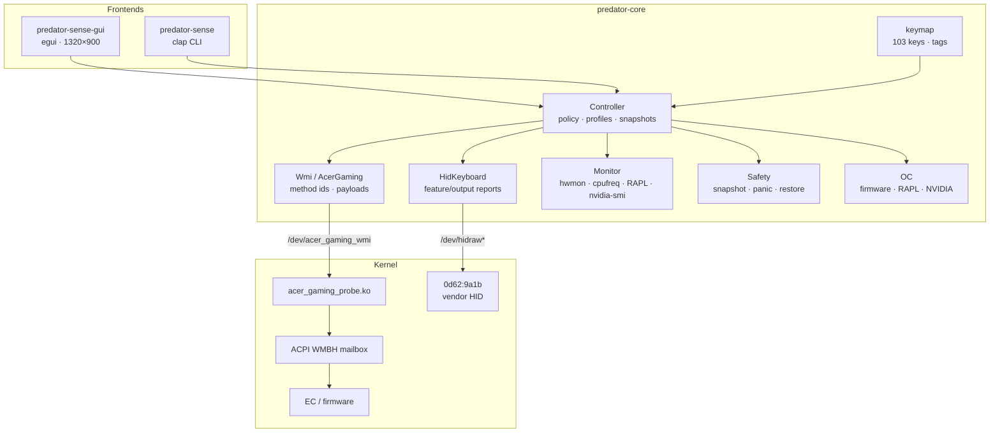

# Architecture

## Goals

- Replace the hardware-control surface of Acer PredatorSense on Linux without
  flashing firmware.
- Keep every write reversible, observable and recoverable.
- Keep the protocol knowledge in one place (`predator-core`) so the CLI and GUI
  cannot drift.
- Make the kernel boundary as small as possible: one WMI method call and one
  device node.

## Components

## Data flow

### Lighting

1. A CLI command or GUI edit produces a `LightingState` (mode, brightness,
   effect, per-key colours).
2. `Controller::apply_lighting` checks the `SafetyPolicy`, optionally snapshots,
   and calls `HidKeyboard`.
3. `HidKeyboard` frames the command:
   - static: `0x12` header, 512-byte colour buffer as eight 65-byte reports,
     `0x08 0x02 0x33 0x05` commit;
   - effect: `0x08 0x02`, `0x14` colour, `0x08 0x00` effect;
   - MagForce: `0x30`–`0x35` family.
4. The keyboard firmware updates the LEDs; the getter `0x88` provides a
   readback used by `doctor` and diagnostics.

### Chassis lights, fans, OC

1. `Controller` builds a little-endian u64 payload.
2. `Wmi::call` writes `[method_id] + payload` to `/dev/acer_gaming_wmi`.
3. The kernel module calls `wmi_evaluate_method()` with the gaming-function
   GUID and copies the raw response back.
4. The firmware/EC performs the operation.

### Sensors

`Monitor` reads in parallel:

- WMI health indices 1/2/3/6/10/12/16 (EC temperatures and fan RPM);
- hwmon (`coretemp`, `nvme`, `pch`, GPU driver);
- cpufreq, `/proc/stat`, `/proc/meminfo`, RAPL energy;
- `nvidia-smi` for GPU temperature/clock/load/power/memory;
- power supply for AC/battery state.

The GUI samples in a worker thread; the CLI samples on demand.

## Safety model

`SafetyPolicy` is a single struct shared by every entry point:

| field | effect |
|---|---|
| `allow_writes` | `--read-only` / GUI toggle; read-only commands still work |
| `allow_oc` | `--allow-oc` / GUI toggle; required for EC OC, RAPL and NVIDIA writes |
| `dry_run` | print or log intended writes, touch nothing |
| `force` | allow raw method ids outside the known 0..=25 range |
| `snapshot_before_write` | capture a JSON snapshot before hardware writes |

`panic` bypasses `allow_writes` because it writes a safer state, but still
honours `dry_run`. `restore` loads the latest snapshot and either applies its
profile or the safe state.

## Configuration and state

| path | contents |
|---|---|
| `~/.config/predator-sense/profiles/*.toml` | user profiles |
| `~/.local/state/predator-sense/snapshots/*.json` | recovery snapshots |
| `~/.local/state/predator-sense/snapshots/latest.json` | most recent snapshot |

The pre-rename `~/.config/acer-lighting` and
`~/.local/state/acer-lighting` directories are copied once on first use; the
originals are left untouched.

## Packaging

- `packaging/install.sh` builds the workspace, installs the binaries, creates
  the `predator-sense` group, installs the udev rule, desktop entry, docs,
  systemd unit and DKMS module.
- `packaging/99-predator-sense.rules` grants the group and seat uaccess access
  to the vendor HID and the WMI device.
- `systemd/predator-sense-apply.service` is an enabled oneshot unit that
  applies the `default` profile at boot.
- `packaging/uninstall.sh` removes the installed files and DKMS module while
  preserving user profiles and snapshots.

## Kernel module

`kmod/acer_gaming_probe.c`:

- registers a misc device `/dev/acer_gaming_wmi`;
- `write()` takes `[method_id] + payload`;
- `read()` returns the last raw WMI response;
- calls `wmi_evaluate_method()` by GUID;
- does not claim the WMI device or replace `acer-wmi`;
- GPL-2.0-or-later.

The module is intentionally small. The protocol lives in userspace, so the
interface can be audited and updated without a kernel rebuild.

## Compatibility notes

- The HID channel uses VID/PID `0d62:9a1b`; the tool discovers the `0xFF01`
  interface by sysfs `HID_PHYS`/report descriptor and verifies it with the
  `0x88` getter.
- The WMI channel is model-independent at the mailbox level, but individual
  LED groups/fans may be inert on a given firmware. `docs/PARITY.md` records
  what was observed on the PH717-71.
- The GUI uses egui/eframe; it supports X11 and Wayland.
